<h1 align="center">🏎️ PITWALL 🏁</h1>
<p align="center"><b>When do you pit? A stochastic answer.</b></p>

<p align="center">
  <b><a href="https://claudialbombin.github.io/pitwall/">▶ Live site</a></b> ·
  <a href="https://claudialbombin.github.io/pitwall/simulator.html">Simulator</a> ·
  <a href="https://claudialbombin.github.io/pitwall/explainer.html">The math</a> ·
  <a href="https://claudialbombin.github.io/pitwall/live.html">Live dashboard</a> ·
  <a href="paper/paper.pdf">Paper (PDF)</a>
</p>

<p align="center">
  <a href="https://github.com/claudialbombin/pitwall/actions/workflows/ci.yml"></a>
  <a href="https://github.com/claudialbombin/pitwall/actions/workflows/deploy.yml"></a>
  
  <a href="LICENSE"></a>
</p>

🏎️ F1 pit-stop timing formulated as a finite-horizon **Markov Decision Process (MDP)**, solved exactly by backward induction, with 🛞 tyre degradation modelled by **Gaussian Process regression** and 🚨 safety-car risk modelled as a **Bayesian non-homogeneous Poisson process**.

The fun part: the pit/stay decision turns out to be *mathematically the same problem* as deciding whether to exercise an American option early. Both boil down to "is what I get now better than the expected value of waiting?" — and both are solved the same way, working backwards from the end. So the machinery Wall Street uses to price early exercise on a derivative is, unmodified, the machinery that tells you when to bring an F1 car into the pits. 💸➡️🏎️

> 📊 **Honest status: against 57 real 2023 driver strategies at 3 circuits, the policy is faster in 53% of comparisons by a mean of 0.2 s (modelled, not observed, time). In the saved Monte Carlo run at Silverstone it is 48 s slower on average than a baseline heuristic, so this is not yet a proven strategy edge.**

<details>
<summary>📊 <b>The numbers, at a glance</b> (click to expand)</summary>
<br>

| | |
|---|---|
| 🏁 Faster than real 2023 strategy in | **53%** of 57 comparisons (3 circuits) |
| ⏱️ Mean modelled delta | **+0.20 seconds** |
| 🧪 Monte Carlo vs baseline (Silverstone) | **48 seconds slower** |
| 🎲 Monte Carlo trajectories | **10,000** by default (antithetic variates); saved run uses **2,000** |
| 🧮 State-space dimensions | lap × compound × tyre age × position × gaps × stops × SC flag |
| 🛞 Compounds modelled | Soft, Medium, Hard, Intermediate, Wet |
| 🚩 Circuits calibrated | Silverstone, Monza, Monaco, Spa |
| 💶 Cost of the live-timing feature | **€0/month** (see [Live timing](#-live-timing)) |

</details>

## 📋 Contents

- [🎯 What this actually does](#-what-this-actually-does)
- [🧮 The math](#-the-math)
- [📁 Project layout](#-project-layout)
- [📊 Results](#-results)
- [📡 Live timing](#-live-timing)
- [⚙️ Installation](#️-installation)
- [🚀 Usage](#-usage)
- [🌐 The website](#-the-website)
- [📄 Paper](#-paper)
- [📜 License](#-license)

<p align="center">
  
</p>

## 🎯 What this actually does

A race strategist has to decide, **lap by lap**, whether to stay out on ageing tyres or pit for fresh ones. That trade-off is harder than it sounds:

- 🔴 Pitting costs a *guaranteed* ~19–24 seconds sat in the pit lane (varies a lot by circuit — see below).
- 🟡 Staying out costs an *uncertain, growing* amount of lap time as the tyre degrades — worse the longer you leave it.
- 🚨 A safety car can appear at any moment and make an otherwise-terrible pit lap suddenly almost free, because everyone else is driving slowly too.

Pitwall treats this as a **sequential decision problem under uncertainty** and solves it exactly, rather than by rule of thumb ("box on lap 25-ish"). Concretely, the MDP's state (`core/mdp.py`, `State`) tracks:

| Field | Meaning |
|---|---|
| `lap` | current lap number |
| `compound` | tyre compound currently fitted (soft / medium / hard / inter / wet) |
| `tyre_age` | laps completed on the current set |
| `position` | 1 (leading) to 20 (last) |
| `gap_ahead` / `gap_behind` | discretised gap to the cars around it |
| `pit_used` | how many stops already taken (0, 1, or 2) |
| `sc_active` | whether a safety car or VSC is currently out |

At every lap, the only decision is 🟢 **stay out** or 🔴 **pit** (and on which compound). The objective is to minimise *expected total race time* over the rest of the race — not just the next lap, which is exactly why this needs dynamic programming rather than a greedy rule.

The MDP is solved once per circuit by backward induction over the full state space (`core/solver.py`) to produce an optimal pit-lap policy. That policy is then stress-tested by running thousands of Monte Carlo race simulations (`core/race_sim.py`) against both itself and simpler baseline heuristics, and finally checked against what actually happened in real 2023 races (`results/backtest_summary.csv`).

<details>
<summary>🔍 <b>A real example from the backtest</b> (click to expand)</summary>
<br>

A few real rows from `results/backtest_summary.csv` — 2023 Silverstone, actual pit lap the team called vs. what the MDP would have called:

| Driver | Team | Actual pit lap | MDP pit lap | Result |
|---|---|---|---|---|
| VER | Red Bull Racing | 34 | 26 | ✅ MDP faster by 0.41s |
| GAS | Alpine | 32 | 26 | ✅ MDP faster by 0.33s |
| PER | Red Bull Racing | 29 | 26 | ✅ MDP faster by 0.18s |
| LEC | Ferrari | 19 | 26 | ❌ Actual call was faster by 0.52s |

Even the MDP loses sometimes — a real race has traffic, red flags, and driver-specific pace that the model doesn't see. In this comparison it is faster slightly more often than not, and the result depends heavily on the circuit.

</details>

<p align="center">
  
</p>

## 🧮 The math

Full derivations live in the [paper](#-paper) 📄; the short version, section by section:

**🧮 MDP formulation.** The race is a finite-horizon MDP over laps. The value function satisfies a Bellman equation comparing the cost of pitting now against the expected cost of staying out one more lap and re-deciding:

$$V(s) = \min\Big(\underbrace{\text{PitCost}(s)}_{\text{pit now}},\ \underbrace{\mathbb{E}\big[V(s')\ \big|\ s,\ \text{stay}\big]}_{\text{stay out one more lap}}\Big)$$

Backward induction from the final lap gives the optimal pit-lap policy for *every* reachable state in one pass. See `core/mdp.py` for the state-space design and `core/solver.py` for the backward-induction solver.

**🛞 Tyre degradation.** Lap-time loss from tyre wear is modelled with a Weibull hazard, fitted per compound to look for a degradation "cliff" — the point past which pace falls off sharply. The saved fits are weak (negative R²) and find no clear cliff. A Gaussian Process (Matérn 5/2 kernel) is layered on top of that parametric fit to capture circuit- and temperature-dependent variation the Weibull curve alone misses. See `core/tyre_model.py`.

<details>
<summary>💻 <b>Real usage, straight from the docstring</b></summary>

```python
from core.tyre_model import TyreModel
from core.mdp import Compound

model = TyreModel()
model.fit_from_fastf1(year=2023, circuit="silverstone")

delta, uncertainty = model.predict(Compound.MEDIUM, tyre_age=22, return_std=True)
cliff = model.cliff_lap(Compound.SOFT)
```

</details>

**🚨 Safety car risk.** Safety car appearances are modelled as a non-homogeneous Poisson process (deployment timing) combined with a geometric distribution (duration) and a Bayesian layer that updates per-circuit deployment rate from historical data. That means a lap under safety-car risk is priced *correctly* into the pit/stay decision — since a pit stop taken under a safety car is nearly free in time lost. See `core/safety_car.py`.

**🎲 Monte Carlo validation.** The policy is evaluated over simulated race trajectories (10,000 by default, 2,000 in the saved Silverstone run), using antithetic variates to reduce estimator variance for a given sample budget — i.e. more precision for the same compute. See `core/race_sim.py`.

**💸 Isomorphism with quantitative finance.** The pit/stay decision is structurally the same problem as deciding whether to exercise an American option early: both compare an immediate, known payoff against the expected value of waiting under uncertainty, and both are solved with a Snell-envelope-style backward recursion. The paper works this correspondence through in full detail — it's the same reason optimal-stopping theory built for derivatives pricing carries over cleanly to a pit wall.

<p align="center">
  
</p>

## 📁 Project layout

```
core/          🧠 MDP, backward-induction solver, tyre model, safety-car model, race simulator
data/          📥 data pipeline (pitwall-fetch console script) built on FastF1
live/          📡 live-timing companion — follows a session in real time via scheduled GitHub Actions
paper/         📄 the full write-up (paper.tex / paper.pdf) with derivations and the 2023 backtest
results/       📊 generated plots and the season backtest summary (results/backtest_summary.csv)
tests/         🧪 pytest suite
web/           🌐 the GitHub Pages site — simulator, explainer, live dashboard, garage
```

## 📊 Results

Compared with real 2023 strategies at 3 circuits (`results/backtest_summary.csv`, one row per driver per race — actual pit lap vs. MDP-recommended pit lap and the modelled time delta):

- 🏁 MDP policy faster than the actual first-stop lap in **53%** of 57 comparisons
- ⏱️ **+0.20 seconds** mean modelled delta (+0.87 s when counted as faster, −0.54 s otherwise)
- 🚩 Big differences by circuit: Monaco **85%** (+1.01 s), Silverstone **72%** (+0.08 s), Monza **0%** (−0.54 s)
- 🧪 Monte Carlo at Silverstone (N = 2,000): MDP **81.73 min** vs. baseline **80.93 min**, i.e. **48 s slower**
- ⚠️ Limits: deltas are modelled rather than observed, each circuit gets one recommended lap, the Weibull fits have negative R², and the safety-car 90% intervals cover only 8% of laps (see the paper)
- 🛑 Pit-loss differs by circuit — a stop costs **22.0s at Monaco** vs. **23.4s at Monza** in the model (`core/mdp.py`, `PIT_LANE_DELTA`); real-world figures are close (Monaco's pit lane is famously short given the tight track, F1.com puts it nearer 19–20s and Monza nearer 24s — see `tests/test_mdp.py` for the ordering check against those published figures)

<details>
<summary>📈 <b>What's in results/</b> (click to expand)</summary>
<br>

| File pattern | Shows |
|---|---|
| `01_*.png` | Tyre degradation fits by compound, temperature effect, Weibull fit, circuit variation |
| `02_*.png` | Safety-car model: Bayesian calibration, SC duration fit, lap distribution, deployment rate by circuit |
| `03_*.png` | Monte Carlo distribution, backtest scatter, optimal pit windows, value-function heatmap |

</details>

<p align="center">
  
</p>

## 📡 Live timing

`live/` follows a session as it happens, and does it for **€0**. 🆓

Every 5 minutes, `.github/workflows/live-scheduler.yml` checks the hand-maintained calendar in `live/schedule.py`; when a session is live, it dispatches `.github/workflows/live-listener.yml`, which runs for the duration of that session and connects directly to the same undocumented `livetiming.formula1.com` SignalR feed FastF1 itself is built on (`live/signalr_client.py`) — no paid API, no login.

As lap data comes in, `live/state.py` keeps a running `RaceState`, and every few seconds `live/advisor.py` asks the *exact same* `core.solver.PitStopSolver` used offline what it would recommend right now, given the real gaps, tyres, and safety-car status. 🔴 The snapshot is written to `live.json` and pushed to an orphan `live-data` branch (`live/publish.py`); `web/live.html` polls that file straight from `raw.githubusercontent.com`.

<details>
<summary>🤔 <b>Why go to all this trouble instead of just using an API?</b></summary>
<br>

The one mainstream live-timing provider for hobby projects ([OpenF1](https://openf1.org)) charges for its live tier. This had to cost nothing, ever — so instead of a server + database + paid feed, it's: a free GitHub Actions cron job → a free undocumented data feed → a git branch as the "database" → a static page polling a public CDN. No server, no database, no secrets beyond the token GitHub already injects into every Action run.

</details>

See [`live/README.md`](live/README.md) for the full write-up, and the [live dashboard](https://claudialbombin.github.io/pitwall/live.html) 🔴 to watch it during a session.

## ⚙️ Installation

Requires Python ≥ 3.10.

```bash
git clone https://github.com/claudialbombin/pitwall.git
cd pitwall
pip install -e .

# for development (tests, linting, type-checking)
pip install -e ".[dev]"

# for the live-timing feature
pip install -e ".[live]"
```

## 🚀 Usage

**Fetch and cache the underlying F1 data:**

```bash
pitwall-fetch
```

The raw FastF1 cache (about 400 MB) is not stored in the repo; this command downloads it into `data/raw/`. The processed tables in `data/processed/` are committed, so notebooks 01 and 02 run without the download; the 2023 backtest in notebook 03 needs it.

**Solve the MDP for a circuit** (real usage, from `core/solver.py`'s own docstring):

```python
from core.tyre_model import TyreModel
from core.safety_car import SafetyCarModel
from core.solver import PitStopSolver, SolverConfig

tyre = TyreModel()
sc = SafetyCarModel("silverstone")

config = SolverConfig(total_laps=52, circuit="silverstone")
solver = PitStopSolver(config, tyre, sc)

policy, values = solver.solve()
action = policy[state.key()]  # 🟢 stay out, or 🔴 pit — for any state you build
```

**Run the test suite:**

```bash
pytest
```

Explore `core/` directly — every module's docstring walks through the theory behind it alongside the implementation, and most classes include a runnable usage example just like the one above.

## 🌐 The website

The `web/` directory is a static site (deployed via `.github/workflows/deploy.yml`) with:

- 🏎️ **[Simulator](https://claudialbombin.github.io/pitwall/simulator.html)** — run the MDP interactively against a chosen circuit and tyre allocation
- 🧮 **[The Math](https://claudialbombin.github.io/pitwall/explainer.html)** — the derivations above, walked through visually
- 📡 **[Live](https://claudialbombin.github.io/pitwall/live.html)** — the live-timing dashboard
- 🛞 **[Garage](https://claudialbombin.github.io/pitwall/garage.html)** — the four animations above, playable interactively: pick a scenario, control playback speed, hover a part (front wing, halo, sidepod, wheel gun…) to highlight it

## 📄 Paper

The full derivation — MDP formulation, tyre degradation model, safety-car model, the options-pricing isomorphism, Monte Carlo validation, and the 2023 season backtest — is written up in [`paper/paper.pdf`](paper/paper.pdf) (source in `paper/paper.tex`).

## 📜 License

MIT — see [LICENSE](LICENSE).

---

<p align="center"><sub>🏁 Claudia Maria Lopez Bombin 🏁</sub></p>
